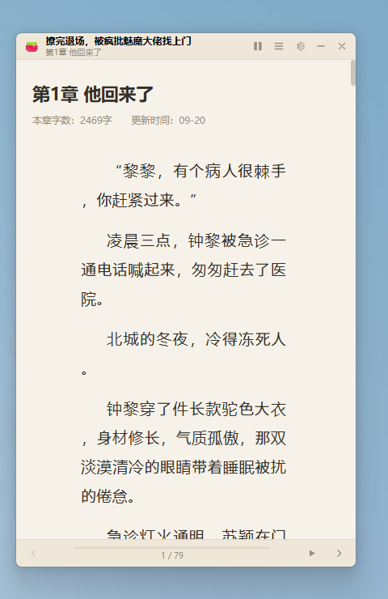

# 🍅 番茄小窗（Fanqie Mini Reader）

一枚常驻桌面角落的**番茄小说迷你阅读小窗**：无边框、始终置顶、可鼠标穿透、可一键隐藏（老板键），专为"边干活边看书"设计。

> 仅用于个人阅读已授权免费的公开章节；内容加载自番茄小说官方网页版（fanqienovel.com），VIP/付费章节需自行登录账号，本项目不破解、不批量下载。



 

## ✨ 功能

| 功能 | 说明 |
| --- | --- |
| 桌面小窗 | 无边框迷你窗口，可拖拽、可缩放，记住位置与大小 |
| 置顶 | 默认窗口置顶，悬浮在所有应用之上（`Alt+C` 切换） |
| 鼠标穿透 | 开启后窗口不挡鼠标操作（`Alt+V` 切换，托盘可关闭） |
| 老板键 | `Alt+X` 全局隐藏 / 唤出，托盘常驻 |
| 链接打开 | 支持手机分享短链（`changdunovel.com/t/...`）、网页链接、分享文案、纯书籍 ID |
| 本地 TXT | 可直接打开本地 TXT（自动按「第X章」分章，含目录/进度/主题/自动滚动）；也可用 `--open-txt=路径` 启动即读 |
| 目录 | 自动抓取完整目录（含分卷），支持搜索、跳章 |
| 书架 | 本地书架 + 阅读进度记忆（章节 + 滚动位置），下次打开自动续读 |
| 排版 | 字号 / 行距 / 版心宽度可调；纸白、米黄、夜间、护眼绿四主题 |
| 自动滚动 | 可调速自动滚屏，读完本章自动进入下一章 |
| 章节导航 | 底栏 ‹ › 按钮、`←` `→` 方向键 |
| 透明度 | 窗口整体透明度 30%–100% 可调 |

## 🚀 运行

```bat
git clone https://github.com/huayangxiaobai/fanqie-reader.git
cd fanqie-reader

# 方式一：双击
start-reader.bat

# 方式二：命令行
npm install        # 首次需要（会下载 Electron 运行时）
npm start

# 方式三：启动即打开某本书
electron . --open=https://fanqienovel.com/page/7687509523090656280
```

依赖：Windows 10/11 + WebView2 运行时（系统自带）+ Node.js 18+。

> 国内网络安装 Electron 较慢时，可先设置镜像：
> `set ELECTRON_MIRROR=https://npmmirror.com/mirrors/electron/`

## ⌨️ 快捷键

| 按键 | 作用 |
| --- | --- |
| `Alt+X` | 全局：隐藏 / 唤出小窗（老板键） |
| `Alt+V` | 全局：鼠标穿透 开 / 关 |
| `Alt+C` | 全局：窗口置顶 开 / 关 |
| `←` / `→` | 上一章 / 下一章 |
| `F9` | 自动滚动 开 / 关（或双击底栏） |
| `Esc` | 关闭侧滑面板 |

## 🧱 技术实现

- **Electron 44**：无边框 `BrowserWindow` + 托盘 + 全局快捷键 + `<webview>` 加载番茄官方阅读页
- **阅读模式注入**：`insertCSS` 注入小窗阅读样式（隐藏站点导航/广告、重设版心与字号行距、主题变量 `--fr-*`），不修改页面逻辑
- **目录数据**：调用番茄官网目录接口 `fanqienovel.com/api/reader/directory/detail`，本地缓存 12 小时
- **正文渲染**：直接使用官方页面（自带字体解密渲染），无需破解字体混淆
- **guest 通信**：webview preload 通过 `ipcRenderer.sendToHost` 上报滚动比例 / 章节标题 / 方向键
- **持久化**：`%APPDATA%/番茄小窗/config.json`（设置、书架、进度）+ `toc/*.json`（目录缓存）
- **稳定性**：禁用硬件加速适配无 GPU / 远程桌面；渲染进程反复崩溃时自动以兼容参数重启

## 📁 结构

```
fanqie-reader/
├── src/
│   ├── main.js            # 主进程：窗口/托盘/快捷键/抓取/存储
│   ├── preload.js         # 壳层 API（contextBridge 白名单）
│   ├── reader-preload.js  # 注入阅读页：滚动/按键/章节上报
│   ├── reading-css.js     # 小窗阅读模式 CSS
│   └── renderer/          # 壳层 UI（index.html / style.css / app.js）
├── assets/                # 应用图标
├── scripts/gen_icon.py    # 图标生成脚本
└── start-reader.bat       # Windows 一键启动
```

## 📌 已知限制（实测数据）

番茄**网页版**对未开通 SVIP 的账号只开放目录**前 10 章**，第 11 章起服务端只下发 300~400 字预览并置 `isChapterLock: true`。实测两者的边界完全一致（第 10 章 4629 字全文可读 / 第 11 章仅 365 字）。

绕过尝试均已验证无效，无需重复踩坑：

| 尝试 | 结果 |
| --- | --- |
| 模拟手机 UA（iPhone / Android / 番茄 App WebView / 抖音 WebView） | 与桌面 UA 返回**完全相同**的预览，`isChapterLock` 恒为 `true` |
| 移动端 URL 变体（`?force_mobile=1`、`m.fanqienovel.com`） | 前者无差异，后者域名不存在 |
| 官方 App 接口 `novel.snssdk.com`、`api5-*.fqnovel.com` | 无设备注册与请求签名时一律返回空包（HTTP 200 / 0 字节） |
| 页面数据接口 `/api/reader/full` 等 | 空响应或 404 |
| 开源下载器 | 全部依赖作者私藏中转服务或私有 crate（地址与 token 不开源），公开的那些已失效 |

原因：限制在服务端按**账号权益**计算（正文随 SSR 下发），与客户端指纹无关，因此改 UA / 模拟设备无法获得更多内容。

**可行路径**：番茄手机 App 内全本免费阅读；或在网页端开通 SVIP 畅读权益（本应用支持登录与登录态保持）。想在小窗里读全书，见下节「导出自己 App 内的书」。

## 📤 导出自己 App 内的书（自己的设备、个人阅读）

番茄 App 的下载是**按章加密存储**的（`DecryptKey` + `libdragon_crypt.so`），不是明文 TXT，文件名也是 `chapterId.hashCode()` 之类；不走 App 自身的解密例程拿不到正文。社区现成方案是 LSPosed 模块 **`syh0119/fq-hook`**：它不实现解密算法，而是运行在番茄进程内、借宿主自己的 native 例程把已解密明文截下来，导出 TXT / EPUB。

| 项 | 要求 |
| --- | --- |
| root | Magisk / KernelSU / APatch 任一（没有 root 手机时，可用带 root 的安卓模拟器：MuMu、雷电等） |
| LSPosed | v1.8+，作用域勾选「番茄小说」(`com.dragon.read`) |
| Android | ≥ 10 |
| 关键限制 | 章节台账**只存在于番茄进程存活期间**——先在 App 里把这本**下载或翻一遍**，再在同一进程内导出；番茄被强停后需重来 |
| 输出 | `Download/番茄导出/<书名>.txt`（或 `.epub`，含插图与章节目录） |

拿到 TXT 后直接在小窗里打开：

```
点标题栏「书架」→「打开本地 TXT」，或
electron . --open-txt="D:\Download\番茄导出\书名.txt"
```

小窗会自动按「第X章」分章、生成目录、记住读到的章节与滚动位置。**请仅导出自己有权阅读的内容用于个人阅读，不要传播或再分发。**

## 🔍 GitHub 上的类似项目（调研参考）

| 项目 | Stars | 借鉴点 |
| --- | --- | --- |
| [zhongbai2333/Tomato-Novel-Downloader](https://github.com/zhongbai2333/Tomato-Novel-Downloader) | 4k+ | 番茄目录/正文接口思路 |
| [POf-L/Fanqie-novel-Downloader](https://github.com/POf-L/Fanqie-novel-Downloader) | 2.5k+ | 跨平台下载器，站点反爬应对 |
| [ying-ck/fanqienovel-downloader](https://github.com/ying-ck/fanqienovel-downloader) | 2.4k+ | 番茄网页端解析 |
| [3529/fish-book](https://github.com/3529/fish-book) | 105 | Electron 摸鱼小说阅读器（隐蔽阅读、热键、书架） |
| [LevineHua/single-reader](https://github.com/LevineHua/single-reader) | 52 | 超隐蔽单行阅读器 |
| [triWater-Chen/goof-off](https://github.com/triWater-Chen/goof-off) | 38 | 透明/隐藏内嵌浏览器式阅读器 |
| [z-z-studio/transparent_reader](https://github.com/z-z-studio/transparent_reader) | 2 | 透明置顶电子书阅读窗（Electron） |

本项目的差异化：**直接加载官方网页版正文**（不破解字体混淆、跟随官方更新）、完整目录 + 进度续读、小窗形态更适合追更。

## ⚠️ 声明

- 请支持正版；本项目不提供任何付费章节的解锁能力。
- 仅供学习交流，请勿用于商业用途；如有侵权请联系删除。
